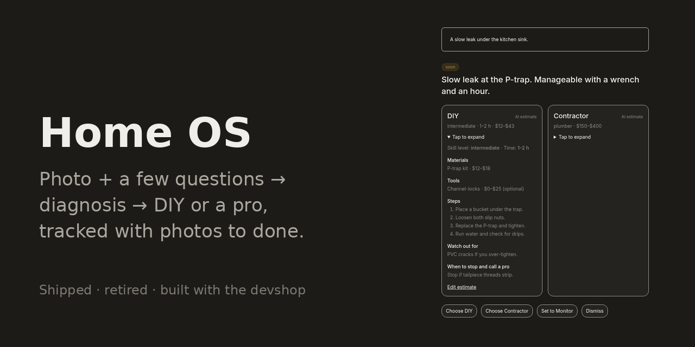

# Home OS

The decide step, captured by the end-to-end test suite with seeded data.

> **Status: Retired — shipped and used; the backend is frozen, so there is no live demo** · last touched 2026-05

Home OS takes a homeowner from "what is that stain?" to a closed issue: photograph it, let the AI triage it with a few questions, choose DIY or a pro with costs in hand, and track it with photos until it's done.

You capture an issue with a photo and a sentence. The AI gives a first read and a severity, asks up to three clarifying questions, then confirms an assessment with a DIY path and a contractor path side by side. You pick one, park it as planned, or put it on a check-in schedule. Check-ins add photos over time, and closing a card records what you spent next to a before/after pair. The tone is deliberately calm: the dashboard shows what actually needs attention, not a list of everything wrong with the house.

## Approach

Built with the devshop method: an AI coding agent (Claude Code) wrote each feature's spec, code, tests and PR. Human in the loop: me (@meirmsn); I reviewed and merged the PRs and improved the devshop between features. Robot hands: Claude Code, committing under @meirmsn with a Claude co-author trailer.

What it taught me: with the agent writing the code, my time went into the specs and the reviews. The first real production bug ([#23](https://github.com/meirmsn/home-os/pull/23)) was one neither could catch: a database grant that the local stack has by default and the production project didn't.

## What it does

- Gives a calm first read on a photo and a sentence, with a severity (act soon, watch, note), before you spend any of your weekly AI sessions.
- Asks up to three follow-up questions, and keeps the whole diagnosis, with its web sources, on the card as "How we diagnosed this".
- Lets you correct the cost and time estimates with your own numbers, and reset them to the AI's.
- Puts issues you aren't fixing yet on a check-in schedule, and batches overdue check-ins into one walkthrough.
- Compares photos of the same spot across dates side by side, with synced zoom and a "bounce" mode that flips between them.
- Gathers every question triage suggested asking a pro, grouped by trade (plumber, electrician, …), as a checklist for the visit.

## How it works

- **The specs came from a PM, not an engineer.** Product discovery was run by a PM using interview skills, who returned written product, engineering and design reviews (1–2 May 2026). The per-feature specs in [`specs/`](specs/) were derived from those; the source reviews aren't in this repo.
- **The devshop built it from those specs** in roughly 48 hours of build time across nine working days in two bursts (13–18 and 26–28 May 2026), one PR per feature, while I reviewed PRs and improved the devshop as it went.
- **Triage is a tool-calling loop.** Claude (with web search) must answer through one of two tools: ask the next question, or confirm the assessment. Its output is checked against fixed shapes before anything is saved, and the same validator guards a user's edits to the estimates. A 75-case set of written home-issue scenarios checks accuracy when the prompt changes; it is run by hand, not in CI.
- **Each card is a state machine in Postgres.** Every transition (triage, decide, plan, monitor, close, dismiss) is one database function, so the weekly caps and session counts can't race. Each table is locked to its owner by row-level security.
- **Spike first:** an operator-only spike page proved phone camera capture and synced zoom before any product code; the real comparison view reuses only its zoom math. Considered and rejected: a single "top item" dashboard, because it forces the app's priority on someone with several real concerns.
- More detail: [`OVERVIEW.md`](OVERVIEW.md) (product) and [`ARCHITECTURE.md`](ARCHITECTURE.md) (system).

## Build log

- **2026-05-13** — Email magic-link sign-in; database with per-user access rules; a spike proving camera capture and synced-zoom comparison on a phone.
- **2026-05-15** — Capture (photo, description, room and system tags, a 20-a-week cap, reversible dismiss) and the AI's first read. First production deploy.
- **2026-05-16** — Clarifying questions and a confirmed assessment; fixes for the first production bugs (a 404 after capture, a 500 on "Read this for me").
- **2026-05-17** — Decide: DIY and contractor paths side by side; choose, monitor or dismiss.
- **2026-05-18** — Planned state with optional reminders.
- **2026-05-26** — Close (spend, finished photo, before/after); weekly AI usage meter and bring-your-own Anthropic key.
- **2026-05-27** — Check-ins on a schedule; tiered dashboard with a walkthrough for overdue check-ins.
- **2026-05-28** — Photo comparison; triage eval set; contractor-questions view; database security and performance hardening.
- **Stopped** — No product work after 28 May 2026, only dependency bumps. The app was retired and the backend frozen.

## Known limitations

- No live demo: the hosted backend is frozen.
- Dashboard card titles are nearly unreadable: light text on a light card (visible in [`specs/dashboard/hero/`](specs/dashboard/hero/)).
- Magic-link sign-in fails in Safari Private Browsing; a normal window works.
- Sign-in emails were capped at about two per hour across all users, and the error says "wait a minute" when the wait can be up to an hour.
- A failed sign-in link shows a generic error with no reason.
- Estimates are AI-generated ranges, not quotes, and there are no contractor listings: it tells you which kind of pro to call, not who.

## Run it

Not runnable without a Supabase stack and an Anthropic API key; the hosted backend is frozen. The original setup is the devcontainer in [`.devcontainer/`](.devcontainer/), which runs Supabase locally: reopen in the container, then `pnpm db:reset` and `pnpm turbo run dev` (test, build and lint commands, local URLs and doc map: [`DEVELOPMENT.md`](DEVELOPMENT.md)). It hasn't been re-checked since the app was retired. Otherwise, see the screenshots, captured per feature by the test suite: [triage Q&A](specs/triage-conversation/hero/), [decide](specs/decide-state/hero/), [monitoring](specs/monitor-beta/hero/), [photo comparison](specs/photo-comparison-ui/hero/), [contractor questions](specs/contractor-question-retrieval/hero/), [close](specs/close-flow/hero/).

## Feedback

Suggestions and critiques welcome — open an issue or a discussion.

## License

[MIT](LICENSE)
